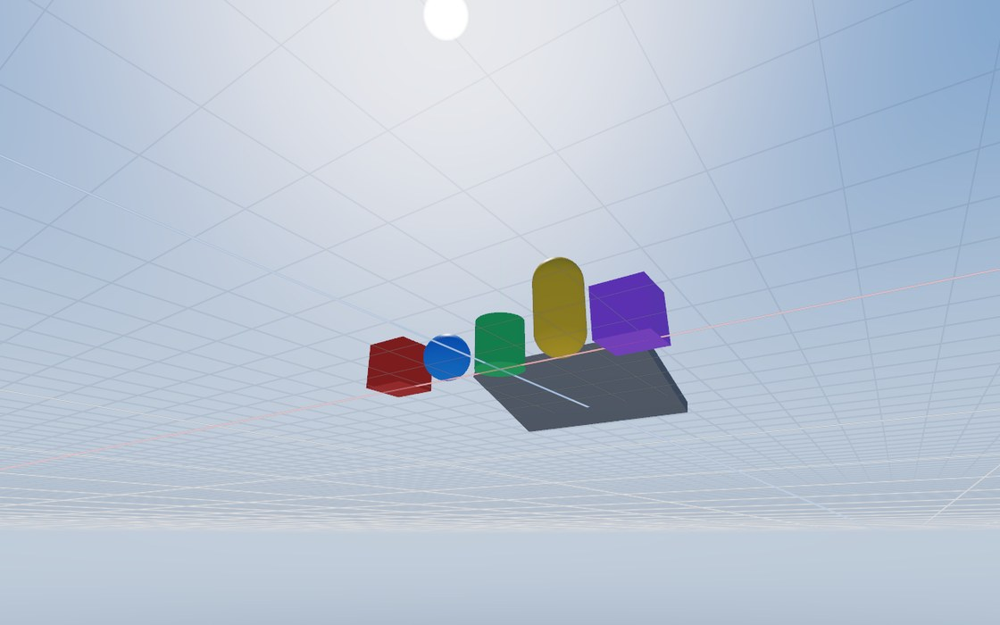
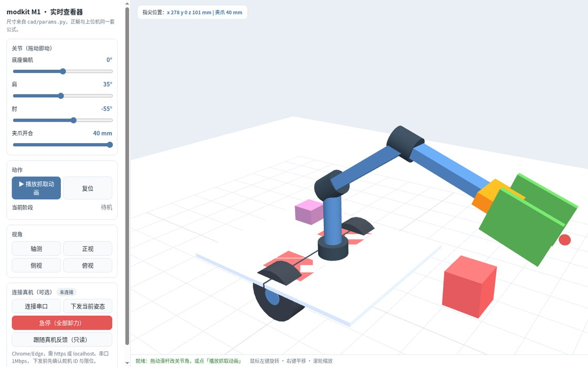

# 你好，我是 gh503 👋

> 日拱一卒。

自动化专业出身，做测试开发与自动化，也写全栈。手上同时有三件事：3D 引擎、模块化机器人、跑在自己机器上的个人助理。

做事的偏好：**接口先定、每层可验证**——先把「现在到哪一步」写清楚，再谈「将来能做什么」。

📍 杭州　🌐 [主页](https://gh503.github.io/)　📝 [博客](https://gh503.github.io/blog/)　🧩 [项目页](https://gh503.github.io/blog/projects/)　✉️ [邮箱](mailto:angus_robot@163.com)

## 现在在做

### [Quench3D](https://github.com/gh503/quench3d) · 纯 Rust 的 3D 引擎

自带从零实现的物理引擎（宽相 / 窄相、顺序冲量求解器、5 种关节、角色控制器），渲染基于 `wgpu`，
桌面端 / Web / CLI / MCP 共用一套代码。引擎本体全部 `#![forbid(unsafe_code)]`。

约 3.7 万行 Rust（CLI 约 1.1 万、编辑器约 0.24 万）+ 650 行 WGSL，另有约 0.8 万行示例与测试。

`v0.1.0`（2026-10）　`Rust` `wgpu` `WASM` `物理仿真`
[在线 Demo](https://gh503.github.io/quench3d/) · [源码](https://github.com/gh503/quench3d)

### [modkit M1](https://github.com/gh503/robot-modkit) · 可拆装的模块化机器人

差速底盘 + 4 自由度机械臂 + 夹爪：参数化 CAD、可测固件、Python 上位机、浏览器实时 3D 查看器。
目标不是拍演示视频，而是能独立完成一件物理任务——导航 → 识别 → 抓取 → 放置。

`make check-fast` 一次跑完 333 项测试 + 16 组网页冒烟 + 11 个装配示例。

`v1.33.1`（2026-10）　`Python` `C++` `CAD` `机器人`
[在线 3D 查看器](https://gh503.github.io/robot-modkit/) · [源码](https://github.com/gh503/robot-modkit)

### [Jarvis](https://github.com/gh503/jarvis) · 本地优先的个人助理

跑在自己机器上的 ambient assistant：文本 / 语音对话（可打断）、按需屏幕 OCR、单帧摄像头、
SQLite 记忆与整合、提醒与晨报、可撤销的设备配对，外加浏览器 PWA 和一个 Studio 观测面。

模型侧支持 OpenAI 与 Anthropic 多套协议和 provider 池，配额、限流、鉴权失败会按优先级自动切到下一个并带冷却。

`npm run memory:eval` 是一套 11 例的召回 / 拒答 / 隐私回归，改记忆逻辑前先跑它。

`TypeScript` `Node 24` `SQLite` `本地优先`
[源码](https://github.com/gh503/jarvis)

## 技术栈

## 其他项目

| 项目 | 是什么 |
| --- | --- |
| [morphic_tui](https://github.com/gh503/morphic_tui) | Rust 写的跨平台 TUI 应用框架 |
| [MiniRobot](https://github.com/gh503/miniRobot) | 分布式后台程序，基于 `Actix` 做节点间通信，完成本地与跨网络作业 |
| [xdeploy](https://github.com/gh503/xdeploy) | 纯 Shell 的部署动作组合 |
| [imservice](https://github.com/gh503/imservice) | 命令行之间、与 Web 之间的即时安全通信 |
| [kb](https://github.com/gh503/kb) | 可搜索、可持续迭代的个人知识库（MkDocs Material + GitHub Pages） |

## GitHub 统计

## 开源贡献

- [CompassCI](https://gitee.com/openeuler/compass-ci): 负责和参与部署功能模块开发，项目组 Committer。

## 我的文章

**主页** 是综合入口，**博客** 在 `/blog` 下，技术笔记和折腾记录都写在那里。

- [个人主页](https://gh503.github.io/) · [博客](https://gh503.github.io/blog/) · [项目页](https://gh503.github.io/blog/projects/) · [归档](https://gh503.github.io/blog/archives/)

最近写的几篇：

- [别再补窟窿了：用结构第一性原理重构你的工作与生活](https://gh503.github.io/blog/2026/03/23/2f2f6ed51ead/)
- [APE/CUE 文件无损转换 FLAC 完整指南](https://gh503.github.io/blog/2026/03/23/9ef23a8df771/)
- [Linux 终端邮件客户端 Himalaya 配置指南](https://gh503.github.io/blog/2026/03/19/066abdf0ab54/)

## 联系方式

📫

- Email: angus_robot@163.com
- QQ: 1226382920

## 兴趣爱好

- 📚 动漫：火影忍者、完美世界、剑来、吞噬星空、一人之下
- 🎸 音乐：周杰伦、王力宏、宫崎骏、轻音乐作品如「流行の云」等
- 🎮 游戏：手游（海岛奇兵）
- 🏃‍♀️ 运动：网球、台球等
- 👨‍💻 科技：机器人、自动化、图形学